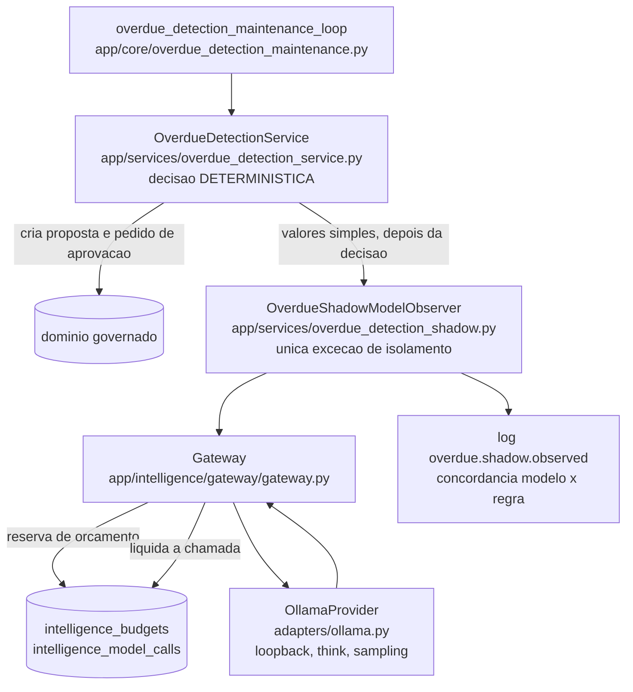

# Modelo local no agente de vencidos - arquitetura e estado (fechamento M7)

Estado conferido contra a `main` em 6991f00 (19/11/2026). Escopo: o modelo local `qwen3:4b` como
OBSERVADOR (shadow) do agente de vencidos. O modelo nao decide nada.

## 1. Decisao vigente

Decisao de Daniel (18/11): continuar em SHADOW. O modelo observa e a decisao segue com a regra
deterministica e a aprovacao humana. A aprovacao desta trilha NAO autoriza o modelo a decidir.

## 2. Componentes e fluxo

Fluxo, em ordem:

1. `OverdueDetectionService` aplica a regra deterministica (conta `aberto` com `due_date` estritamente
   menor que a data de negocio) e cria a proposta consultiva e o pedido de aprovacao pendente. Isso
   acontece com ou sem shadow.
2. Depois da decisao, o servico entrega ao observador valores simples (`OverdueShadowObservation`).
   O servico nao importa a camada de inteligencia: so recebe um observador opcional.
3. O observador monta uma entrada minima e sintetica (`build_model_input`) e chama o Gateway com
   `purpose=overdue_shadow_v2`, `prompt_template_id=overdue-shadow-prompt-v2-think`,
   `output_schema_id=overdue-shadow-output-v1`, `max_output_tokens=4096` e `call_key=overdue-shadow:<id do pedido>`.
4. O Gateway reserva orcamento (pior caso), grava a intencao antes de enviar, chama o provider e
   liquida (`settled`), marca `unknown` ou libera.
5. O `OllamaProvider` (`app/intelligence/gateway/adapters/ollama.py`) so aceita host loopback
   (`127.0.0.1`, `::1`, `localhost`; valida o host e de novo o par conectado) e usa so `http.client` da stdlib.
6. O ledger `intelligence_model_calls` guarda digest do modelo, versao do runtime, latencia, estado,
   tokens e classe de erro. Nao guarda o texto do raciocinio.
7. O observador registra o log `overdue.shadow.observed` com `decision_modelo`,
   `decision_deterministica`, `agreement`, `call_ok`, `error_code`, `final_state` e `reason_length`.
   Saida invalida ou chamada falha = `decision_modelo` nulo e `agreement` nulo (sem decisao).

Montagem: `app/core/overdue_detection_maintenance.py` so constroi o observador se
`OVERDUE_SHADOW_ENABLED=true`; se a construcao falhar, loga `overdue.shadow.build_failed` e segue sem
observador (falha fechada). Perfil de modelo: `local-qwen3-4b` (`app/intelligence/gateway/profiles.py`).

## 3. Garantias

- A saida do modelo nunca altera titulo (conta), aprovacao, proposta, evento, chave de idempotencia
  ou contadores da rotina. O observador roda depois da decisao e uma excecao dele e apenas logada.
- O texto do raciocinio nunca e gravado: o adaptador mede `len(thinking)` e descarta o texto; o log
  guarda so `reason_length`.
- So dado sintetico: `OVERDUE_SHADOW_DATA_CLASSIFICATION=synthetic` e obrigatorio; o observador
  recusa outra classificacao; `REAL_DATA_ALLOWED` e constante de codigo (`False`).
- Recusado em producao em varias camadas: `config.py` (`OVERDUE_SHADOW_ENABLED` invalido com
  `APP_ENV=production`), `build_overdue_shadow_observer` e o Gateway (`INTELLIGENCE_MODE=shadow` em
  producao e erro, com nova checagem em tempo de execucao).
- Origem preservada: o observador so e acionado na varredura do agente (origem "agente com aprovacao
  humana"). A rota manual (humano) e a origem autonoma L3 nao consultam o modelo.

### Flags e travas

| Item | Valor/efeito |
|---|---|
| `INTELLIGENCE_MODE` | `off` (padrao) ou `shadow`; `governed`/`bounded` recusados na inicializacao |
| `OVERDUE_SHADOW_ENABLED` | padrao desligado; exige modo shadow, classificacao `synthetic`, orcamento, modelo e digest de 64 hex; recusado em producao |
| `OVERDUE_SHADOW_MAX_ACCOUNTS_PER_RUN` | limite de contas por rodada (a homologacao usa 1); duplicadas nao consomem o limite |
| `OVERDUE_SHADOW_DEPLOYMENT_BUDGET_ID`, `OVERDUE_SHADOW_MODEL_ID`, `OVERDUE_SHADOW_MODEL_DIGEST` | orcamento, modelo e digest aprovados |
| `INTELLIGENCE_CALL_TIMEOUT_SECONDS` | teto geral 120 s; 300 s so com shadow ligado + modo shadow + fora de producao |
| `INTELLIGENCE_MAX_ATTEMPTS` | 1 na homologacao (sem retry) |
| Orcamento de 1 chamada | limite de tokens = reserva de pior caso de UMA tentativa (7170 com a margem padrao); a admissao atomica do ledger impede a segunda. Chamada `unknown` bloqueia nova admissao e nao se repete |
| `call_key` | unica por pedido de aprovacao: reexecucao nao repete a chamada |

### Fronteira testada

- `backend/tests/test_intelligence_boundaries.py`: nenhum modulo da aplicacao importa o Gateway
  (`test_no_application_module_imports_the_gateway`), `main` e routers nao citam inteligencia, nenhuma
  rota, permissao ou papel do Gateway, so um modulo usa `http.client`
  (`test_only_the_named_module_uses_http_client`), nada fora de inteligencia importa o adaptador Ollama,
  chamada completa sem rede, so `APP_ENV` lido do ambiente.
- `backend/tests/test_overdue_detection_shadow.py` (AST e contrato): a excecao e um caminho exato
  (`test_exception_is_one_exact_path`); so ela foi acrescentada aos importadores de inteligencia; so a
  montagem referencia o modulo shadow (`test_no_other_module_references_the_shadow_module_except_assembly`);
  o modulo nao importa execucao, repositorio nem modelos e nao escreve no dominio governado
  (`test_shadow_module_imports_no_execution_repository_or_model`, `test_shadow_module_writes_nothing_of_the_governed_domain`);
  modulos de execucao e humanos nunca veem o observador; contadores identicos com qualquer observador;
  falha do observador e logada, nao propagada; desligado por padrao e recusado em producao.
- `backend/tests/test_overdue_detection_shadow_db.py` (banco, mundos gemeos): estado governado identico
  com e sem shadow; excecao do observador nao muda nada; origem agente mantem solicitante e chave;
  limite por rodada com ledger real; nova varredura nao reconsulta o modelo; sessao liberada antes da
  chamada; origem manual (`test_manual_origin_does_not_consult_the_model`) e L3
  (`test_l3_origin_does_not_consult_the_model`) nao consultam o modelo.
- Outros: `test_intelligence_ollama_thinking.py`, `test_overdue_shadow_prompt_v2.py`,
  `test_intelligence_config_flags.py`, `test_eval_overdue_shadow.py`.

## 4. Configuracao aprovada

| Item | Valor |
|---|---|
| Modelo | `qwen3:4b` (Qwen3-4B-Thinking-2507), digest `359d7dd4bcdab3d86b87d73ac27966f4dbb9f5efdfcc75d34a8764a09474fae7` |
| Runtime | Ollama 0.40.16 (`EXPECTED_OLLAMA_VERSION` em `scripts/eval_overdue_shadow.py`) |
| Raciocinio | `think=true` |
| Saida | `num_predict` 4096 (raciocinio + JSON) |
| Amostragem | temperature 0,6, top_p 0,95, top_k 20, seed 0 |
| Prompt | `overdue_shadow_v2`; template `overdue-shadow-prompt-v2-think` (texto do v2 inalterado; o ledger distingue as chamadas com raciocinio das anteriores) |
| Perfil | `local-qwen3-4b`, preco zero, sem fallback |

## 5. Historico de avaliacao (dados reais)

Conjuntos de 80 casos. v1 = ajuste (`backend/evals/overdue_shadow/cases_v1.json`); v2 = prova selada (`cases_v2.json`).

| Data | Configuracao | Resultado |
|---|---|---|
| 16/11 | sem raciocinio, prompt v1 | 63/80; 17 acoes indevidas |
| 18/11 | raciocinio, 2048 tokens, v1 | 67/80; 13 truncadas; 0 acoes indevidas |
| 18/11 | raciocinio, 4096 tokens, v1 | 80/80 |
| 18/11 | raciocinio, 4096 tokens, PROVA v2 | 79/80; 0 acoes indevidas; 1 conta vencida sem resposta valida por truncamento |

Fonte: evidencias das rodadas em `C:\Users\Tomaz\Downloads\arquivos gerados\area3-evidence-20261105\`
(pastas `aval-qwen-*`), confirmadas pelo PO. Ficam fora do repositorio.

Leitura: o prompt v2 e o limite de 4096 resolveram as acoes indevidas e quase todas as truncagens. O
unico erro da prova e omissao por truncamento (conta vencida sem resposta valida), nao acao indevida.
Por isso o modelo permanece como observador.

## 6. O que NAO esta feito / limites

- S4 (conferencia contra o contrato de planejamento) foi pulada: so faz sentido se o modelo gerar
  plano completo, e hoje ele so observa.
- As outras 3 rotinas: monitor de recebiveis e memoria de comportamento nao precisam de modelo;
  classificacao de cliente e candidata opcional, sem valor de produto.
- Rodada real do shadow com raciocinio na homologacao AINDA NAO feita: a S5 foi com `think=false`; o
  orcamento novo `s5-shadow-overdue-synthetic-think-4096` esta por provisionar
  (veja `backend/docs/operations/S5_SHADOW_RUNBOOK.md` e `RUNBOOK_HOMOLOGACAO.md`).
- L3 autonomo desligado por padrao (`POLICY_MARK_OVERDUE_TRIGGER_ENABLED=false`, `config.py`). Ligar
  depende de decisao e autorizacao especificas de Daniel; o deploy sozinho nao autoriza autonomia.
- Nao ha uso com dado real nem em producao.

## 7. Documentos relacionados

`backend/docs/operations/S5_SHADOW_RUNBOOK.md`, `backend/docs/operations/RUNBOOK_HOMOLOGACAO.md`,
`backend/docs/intelligence/OVERDUE_EVAL_PROTOCOL.md`, `backend/docs/intelligence/GATEWAY_CONTRACT.md`,
`backend/evals/overdue_shadow/README.md`.
